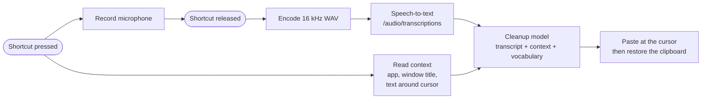

# Utter

Utter is open-source voice typing that understands where you are typing. Hold a shortcut, talk, and let go. Utter transcribes what you said, cleans it up with a language model that knows which app you are in and what is written around your cursor, and pastes the result where your cursor is.

It has no server and no account. You bring your own API keys, and requests go straight from your computer to the providers you choose. Groq's free tier is enough to get started.

macOS is the first platform. The architecture is cross-platform (Tauri and Rust), and Windows and Linux are planned.

## Install

Install with [Homebrew](https://brew.sh):

```sh
brew install --cask leonardogavaudan/tap/utter
```

Or download the latest `.dmg` from [Releases](https://github.com/leonardogavaudan/utter/releases/latest), open it, and drag Utter into Applications. It is signed and notarized by Apple, runs on Apple silicon and Intel Macs with macOS 13 or later, and updates itself.

On first launch, Utter's setup checklist walks you through allowing Accessibility and the microphone and adding a speech-to-text API key.

## How it works



1. When you press the shortcut, Utter starts recording and, in parallel, reads the frontmost app's name, its window title, the text around your cursor, and the other text visible in that window, through the macOS Accessibility API.
2. When you release it, the recording is resampled to 16 kHz mono and sent to an OpenAI-compatible speech-to-text endpoint, with your vocabulary as a spelling hint.
3. The transcript goes to the cleanup model with the context. The model fixes punctuation, removes filler words, keeps only the corrected version when you correct yourself, and spells names the way they appear on screen. If cleanup fails, Utter types the raw transcript and tells you.
4. Utter pastes the text with a simulated ⌘V and puts your previous clipboard text back afterwards. If you switched apps while it was working, it copies the text to the clipboard instead of pasting into the wrong place.

Press Escape while recording to cancel. Recordings stop on their own after five minutes.

## Privacy

- **No server.** Audio goes only to your speech-to-text provider. The transcript and context go only to your cleanup provider.
- **Text, not screenshots.** Context comes from the Accessibility API. Password fields are never read. You choose how much context to send: everything visible in the window (up to 2,000 characters, nearest your cursor first) plus the text around the cursor; only the text around the cursor (400 characters before, 200 after, and any selection); only the app and window title; or nothing. Only text that is on screen is read: apps such as chat clients drop messages you have scrolled past, so those are never sent.
- **Nothing kept on disk** except `settings.json`. API keys are stored in the macOS Keychain, or read from environment variables (see Providers). The last dictation is kept in memory only, so you can see it in Settings. Logs record sizes and timings, never what you said.
- **Clipboard managers skip Utter's text.** The pasted text is marked as transient, so tools like Maccy or Raycast do not save it to their history.

## Providers

| Provider | Speech to text | Cleanup | API |
|---|---|---|---|
| Groq | yes | yes | OpenAI-compatible |
| OpenAI | yes | yes | OpenAI-compatible |
| OpenRouter | no | yes | OpenAI-compatible |
| Anthropic | no | yes | Messages API |
| Ollama | no | yes | OpenAI-compatible, local |
| LM Studio | no | yes | OpenAI-compatible, local |
| ElevenLabs | yes (Scribe) | no | ElevenLabs speech-to-text API |
| Custom | yes | yes | Any OpenAI-compatible server |

Speech-to-text and cleanup can use different providers. A provider's key is shared between the two, except for Custom endpoints, which each keep their own.

If a hosted provider's key is in Utter's environment under the usual name (`GROQ_API_KEY`, `OPENAI_API_KEY`, `OPENROUTER_API_KEY`, `ANTHROPIC_API_KEY`, `ELEVENLABS_API_KEY`), Utter uses it instead of the Keychain, and Settings shows which variable it came from. Apps opened from the Dock get their environment from launchd, so set it there, for example with `launchctl setenv GROQ_API_KEY ...`.

Your vocabulary list reaches each speech-to-text model in the form it understands: as the prompt for OpenAI-compatible models, and as keyterms for ElevenLabs (up to 100 terms of at most 5 words each; ElevenLabs charges 20% more for keyterms).

## Development

You need Rust 1.88 or later, [Bun](https://bun.sh), and the Xcode command-line tools.

```sh
bun install
bun run dev      # run the app with hot reload
bun run check    # rustfmt, clippy, all tests, TypeScript, Biome
bun run build    # release .app and .dmg in target/release/bundle
```

`bun run dev` starts the binary from your terminal, so macOS grants microphone and Accessibility access to the terminal app instead of Utter. To test permissions the way users get them, build the bundle and open it:

```sh
bun run build:dev
open "target/debug/bundle/macos/Utter Dev.app"
```

Local builds are called Utter Dev and use their own app ID, so their permissions, settings, and saved API keys stay separate from an installed copy of Utter.

macOS ties Accessibility, microphone, and Keychain access to the app's signature. Ad-hoc signatures change on every build, so each rebuild would need the permissions granted again. Create a self-signed signing identity once and build with it, and the grants survive rebuilds:

```sh
openssl req -x509 -newkey rsa:2048 -nodes -keyout key.pem -out cert.pem -days 3650 \
  -subj "/CN=Utter Local Signing" -addext "basicConstraints=critical,CA:FALSE" \
  -addext "keyUsage=critical,digitalSignature" -addext "extendedKeyUsage=critical,codeSigning"
/usr/bin/openssl pkcs12 -export -inkey key.pem -in cert.pem -name "Utter Local Signing" -out identity.p12 -passout pass:temporary
security import identity.p12 -k ~/Library/Keychains/login.keychain-db -P temporary -T /usr/bin/codesign
rm key.pem cert.pem identity.p12

APPLE_SIGNING_IDENTITY="Utter Local Signing" bun run build:dev
```

To run the whole pipeline on a recording, without the app (Groq by default; `UTTER_TRANSCRIPTION_PROVIDER=elevenlabs` with `ELEVENLABS_API_KEY` switches speech-to-text, and `UTTER_VOCABULARY` takes comma-separated terms):

```sh
GROQ_API_KEY=... cargo run -p utter-core --example dictate_file -- recording.wav "text before the cursor"
```

To see what Utter would read from a text field, run this and click into the field within five seconds:

```sh
cargo run -p utter-os --example inspect_context -- 5
```

### Layout

| Path | What it holds |
|---|---|
| `crates/utter-core` | Everything that does not touch the operating system: settings, provider presets, audio encoding, the speech-to-text and cleanup clients, the prompt, and the pipeline. Tested against mock HTTP servers. |
| `crates/utter-os` | Operating-system integration: microphone capture (cpal), Accessibility context reading (macOS), clipboard and paste keystroke, permission checks. |
| `src-tauri` | The app shell: tray icon, global shortcut, dictation state machine, overlay window, Keychain storage, and the commands the UI calls. |
| `src` | The React UI: the settings window and the dictation overlay. `src/bindings` is generated from the Rust types by ts-rs (`bun run bindings`). |

## Status

Implemented on macOS, but not yet tested end to end with real providers: the shortcut in hold or toggle mode, recording, context reading in native and web text fields, both cleanup APIs, pasting with clipboard restore, the overlay, the tray icon, Keychain storage, and the settings window.

Not done yet:

- Windows and Linux. The code has separate paths for them, but they have not been compiled or tested. Context reading still needs UI Automation on Windows and AT-SPI on Linux.
- The Fn key and other modifier-only shortcuts, which need a keyboard event tap.
- Local speech-to-text (whisper.cpp or Apple's SpeechAnalyzer).
- A live microphone level in the overlay, and choosing a microphone.
- Keeping the last recording so a failed transcription can be retried.
- Restoring images and rich text on the clipboard. Only plain text is restored today.

## License

MIT
